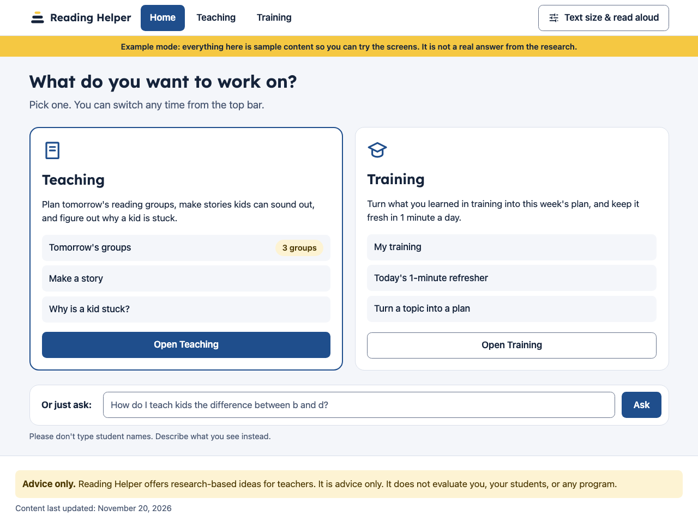
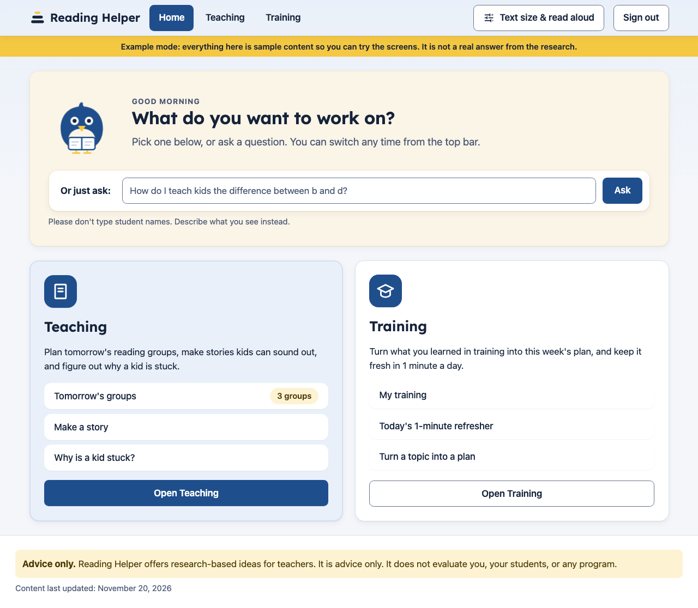
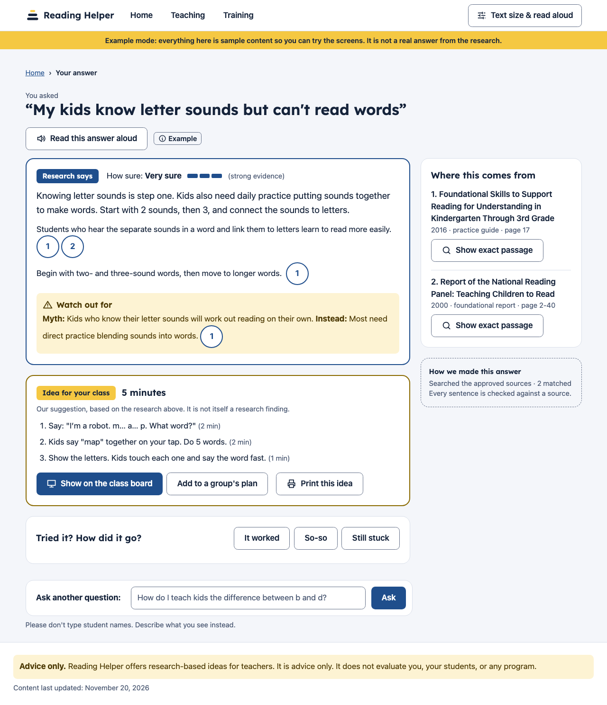
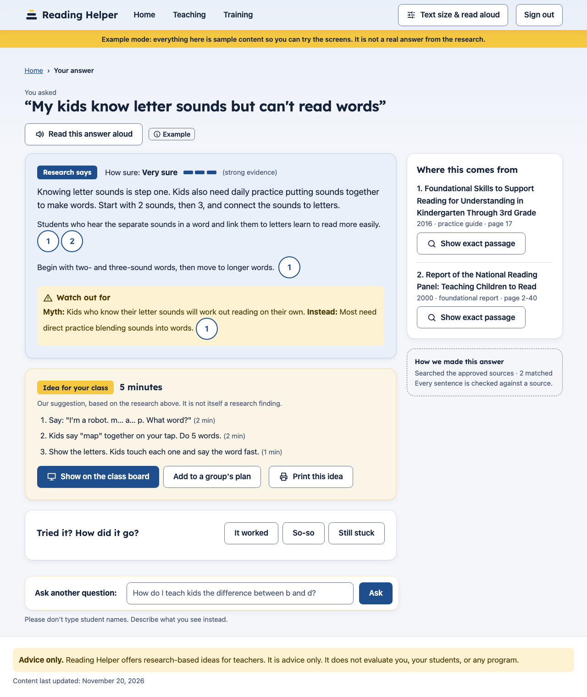
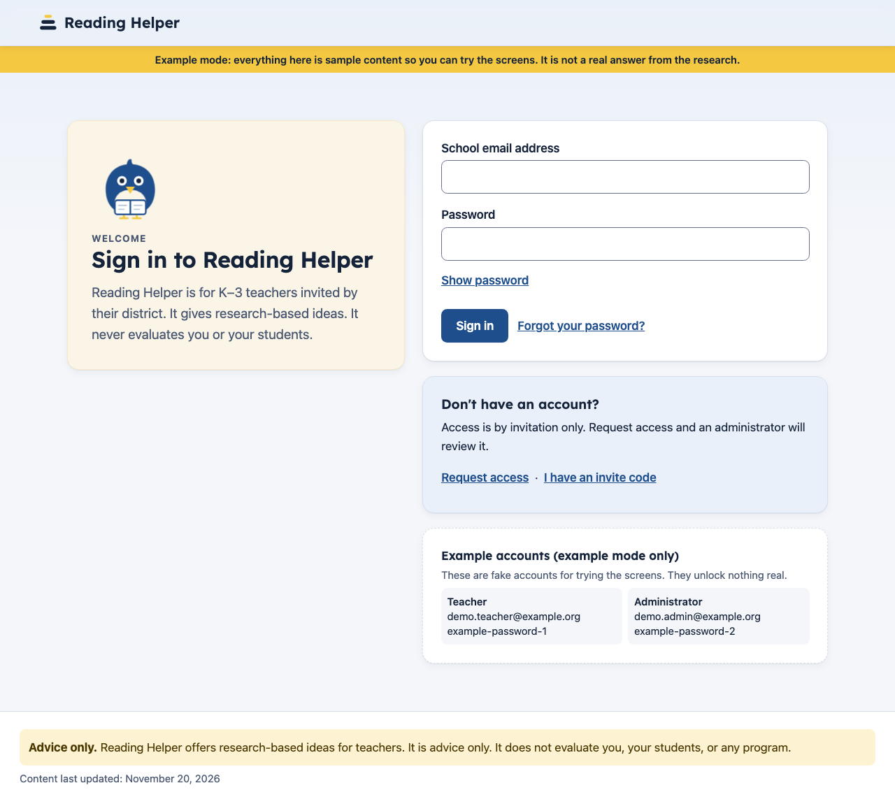

# Overnight summary: redesign, mascot, motion, sign-in (web/ only)

Branch `viktoriia/frontend`. No AWS, no merges. Everything is pushed.

## Before and after
| | Before | After |
|---|---|---|
| Home |  |  |
| Answer |  |  |
| Sign in | (did not exist) |  |

Other new screenshots in `web/docs-screens/`: 04-loading (thinking Wren), 05-no-research, 16-request-access,
17-request-received, 18-forgot-password, 19-admin-access-requests. All 14 earlier screens were re-shot.

## What was done
1. **Research and direction** (`docs/DESIGN_DIRECTION.md`): 10 references with what each does well and how
   confident I am (several searches returned thin or secondary sources, and the doc says so). Direction: "Quiet
   study": navy anchor, warm cream surfaces, cool tint panels, one golden accent, two-layer shadows, fluid type.
2. **Mascot**: three original options (Wren bird, Ribbon bookmark, Stack) in the doc; **Wren chosen**, with idle,
   thinking, pointing and nothing-found states. Used on Home, loading, no-research and the public screens; never in
   answers, sources or citations (tested).
3. **Motion**: card entrance, hover lift and press, Sources panel slide, mascot blink/bob/thinking dots. All of it
   stops under the OS reduced-motion setting and the in-app "Less moving" switch (tested).
4. **Sign-in (closed access)**: sign in, request access (name, school email, district/school, role), request
   received, forgot password (+ "check your email"), set password from an invite code, sign out in the header.
   Every app route requires sign-in and returns you to where you were going; `#/admin` needs the admin role.
   Admin has a new **Access requests** tab (approve with a one-time invite code, deny with a required reason)
   next to the source queue. Built to `docs/API_CONTRACT.md` (bearer token, `sign-in`, `me`, `sign-out`,
   `accept-invite`, admin approve/deny); the client now sends `Authorization: Bearer` on every call. Mock mode uses
   fake `example.org` accounts (shown on the sign-in screen in example mode only), behind the same
   `VITE_API_MODE` switch.
5. **Kept**: all 14 screens, no-scores rule, Behavior/Progress flags off, disclaimers and dates in every footer.

## Tests
136 Playwright tests pass: axe 0 serious/critical on every screen at 1280px and 375px (14 teacher screens, 6
public screens, admin and its new tab), 48px targets (64px on the class board), 320px reflow at extra-large text,
an end-to-end invite loop (request, admin approves, new teacher sets a password and signs in), route guards, and
the motion and mascot rules. Lint, typecheck and build are clean.

## Things that need your decision or attention
- **Role field vs contract.** You asked for a role on Request access; the contract's `request-access` takes only
  `{name, email, district}`. For now the client sends the role inside the district text ("Example Elementary
  (Reading coach)"). Better: add `role` to the contract, or tell me to drop the field.
- **Forgot password has no endpoint** in the contract (Cognito will replace sign-in flows in Phase 5). In real mode
  the page says the administrator can help; mock mode simulates it. It always gives the same answer, so it cannot
  reveal who has an account.
- **The server side (`accounts.py`) did not exist yet** when I looked, so the real client is untested against it.
  The admin source-queue calls (`web/src/admin/api.ts`) still send no bearer token; they need the same header.
- **Contract changes I have not applied yet** to the teacher-screen types: `query_id` on answers and feedback, `Meta`
  on every feature response, `Story.checks / all_decodable / flagged` (the app should use the server's word checks
  instead of its illustrative checker), `MistakeResult.research_says`, `POST /api/decodable/check`, and a `422` for
  anything that looks like a name in "Why is a kid stuck?". Worth a separate pass.
- **Still not done:** a real screen-reader pass; the `frontend-design` skill is not installed here, so I used the
  `design:accessibility-review` checklist (see `docs/ACCESSIBILITY_REVIEW.md`, v2 addendum).
- Example-mode sign-in shows fake passwords on screen. That only happens in mock mode.
